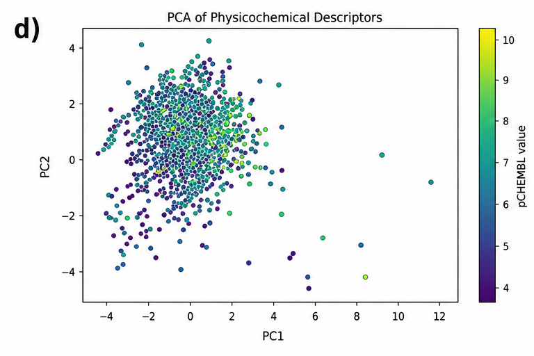

# 02-GABAA-Potency-Prediction

## Overview

This project investigated machine learning approaches for predicting
compound potency at the GABA-A receptor, an important pharmacological
target associated with neurological and psychiatric disorders.

Using bioactivity data from ChEMBL, the study compared
physicochemical molecular descriptors with Morgan circular
fingerprints to investigate how molecular representation affects
predictive performance.

The project combined cheminformatics, dimensionality reduction,
supervised machine learning, feature interpretation, and active
learning to explore structure–activity relationships relevant to
GABA-A receptor modulation.

> **Project archive:** This repository documents the methodology and
> results of the original project. The original source code is no longer
> available following hardware failure, so this repository is presented
> as a project case study rather than a fully reproducible implementation.

## Objectives

The project aimed to:

- Develop machine learning models for predicting GABA-A receptor potency.
- Compare physicochemical descriptors with Morgan circular fingerprints
  as molecular representations.
- Compare nonlinear Random Forest regression with a linear Ridge
  regression baseline.
- Explore the chemical space using PCA and UMAP.
- Investigate molecular features associated with predicted potency.
- Evaluate whether active learning could achieve competitive predictive
  performance using fewer training instances.

## Dataset

Bioactivity data for the rat GABA-A receptor were obtained from
**ChEMBL**.

After data curation, the final dataset contained **2,038 unique
compounds**. Duplicate molecular structures, invalid molecules, and
records with missing information were removed before modelling.

Experimentally determined **pChEMBL values** were used as the target
measure of compound potency.

Molecular structures were processed using **RDKit** and represented
using two approaches:

### Physicochemical Descriptors

Global molecular properties included:

- Molecular weight
- LogP
- Topological Polar Surface Area (TPSA)
- Hydrogen-bond acceptors
- Hydrogen-bond donors
- Rotatable bonds
- Ring count

### Morgan Fingerprints

Morgan circular fingerprints were generated using:

- **Radius:** 2
- **Fingerprint length:** 1,024 bits

These fingerprints encode local atomic environments and were used to
investigate whether structural information provided better predictive
performance than global physicochemical properties.

## Chemical Space Analysis

Two dimensionality-reduction approaches were used to explore the
chemical space represented by the different molecular features.

### Principal Component Analysis (PCA)

PCA was applied to standardized physicochemical descriptors.

The first two principal components explained approximately **62% of
the total variance**:

- PC1: **33.19%**
- PC2: **29.93%**

PCA revealed variation associated with molecular size, lipophilicity,
polarity, and hydrogen-bonding properties. However, physicochemical
descriptors did not produce clear separation according to compound
potency.

### UMAP

UMAP was applied to Morgan fingerprints to examine nonlinear
structure within the high-dimensional fingerprint space.

The fingerprint representation revealed local structural clusters,
although activity values remained distributed across multiple
clusters, indicating that structural similarity alone did not
completely determine potency.

**Figure 1.** Exploratory analysis of the GABA-A receptor dataset,
including pChEMBL distribution, descriptor correlations, PCA loading
analysis, PCA chemical space, and UMAP visualization of Morgan
fingerprints.

## Predictive Modelling

Four modelling approaches were evaluated.

### Ridge Regression

Ridge regression was used as a linear baseline to determine whether
compound potency could be predicted using linear combinations of
molecular features.

### Random Forest — Physicochemical Descriptors

A Random Forest regressor was trained using global physicochemical
properties to capture nonlinear relationships between molecular
properties and biological activity.

### Random Forest — Morgan Fingerprints

A second Random Forest model used Morgan fingerprints, allowing the
model to learn nonlinear relationships between local molecular
substructures and compound potency.

### Active Learning

An active-learning framework was evaluated using a Random Forest
regressor. The approach began with a subset of the training data and
iteratively selected additional samples with the aim of improving
sampling efficiency.

## Model Performance

Model performance was evaluated using the coefficient of determination
(R²), Mean Absolute Error (MAE), and Root Mean Squared Error (RMSE).

| Model | R² | MAE | RMSE |
|---|---:|---:|---:|
| **Random Forest — Morgan Fingerprints** | **0.6691** | **0.5916** | **0.7893** |
| Random Forest — Physicochemical Descriptors | 0.5474 | 0.7242 | 0.9232 |
| Active Learning | 0.4919 | 0.7952 | 0.9780 |
| Ridge Regression | 0.1524 | 1.0409 | 1.2633 |

The **Morgan fingerprint-based Random Forest achieved the strongest
predictive performance**, explaining approximately 67% of the variance
in compound potency.

Its performance substantially exceeded both the descriptor-based
Random Forest and linear Ridge regression models.

These results indicate that local molecular environments captured by
Morgan fingerprints provided more useful information for predicting
GABA-A receptor potency than global physicochemical properties alone.

## Active Learning

Active learning was investigated as a potential approach for reducing
the amount of labelled training data required for potency prediction.

The approach showed improvements during early iterations but eventually
plateaued at approximately **R² ≈ 0.49**, remaining below the performance
of the fully trained Morgan fingerprint Random Forest (**R² = 0.669**).

This suggests that uncertainty-driven sampling could improve sampling
efficiency, but did not overcome limitations associated with dataset
size, structural diversity, and experimental variability in this study.

## Feature Interpretation

Feature importance was investigated using impurity-based importance
scores from the Random Forest models.

For fingerprint-based models, important fingerprint bits were mapped
back to their corresponding atomic environments using **RDKit BitInfo**.

This provided a way to investigate which local molecular environments
contributed most strongly to model predictions while recognising that
hashed fingerprint bits may represent multiple related substructures.

## Limitations & Future Work

Several factors may have limited predictive performance:

- Experimental variability across different bioactivity assays.
- Limited dataset size relative to the high-dimensional fingerprint
  representation.
- Reduced representation of compounds at extreme potency values.
- Use of 2D molecular representations without explicit 3D
  conformational information.
- Absence of protein–ligand structural information.

Potential future work could incorporate 3D molecular descriptors,
reduce assay-related experimental noise, and combine ligand-based
features with receptor structural information.

## Key Takeaways

- Molecular representation had a substantial effect on predictive
  performance.

- Morgan fingerprints combined with Random Forest achieved the strongest
  result, with **R² = 0.669**, compared with **R² = 0.547** using
  physicochemical descriptors.

- The poor performance of Ridge regression (**R² = 0.152**) indicated
  that the relationship between molecular structure and GABA-A receptor
  potency was strongly nonlinear.

- Active learning improved predictive performance during early
  iterations but did not outperform the fully trained fingerprint-based
  Random Forest.

- The project demonstrates how cheminformatics and machine learning can
  be combined to investigate structure–activity relationships relevant
  to drug discovery.

## Technologies & Methods

### Programming & Machine Learning

`Python` · `scikit-learn` · `Random Forest` · `Ridge Regression`

### Cheminformatics

`RDKit` · `ChEMBL` · `Morgan Fingerprints` · `Molecular Descriptors`

### Data Analysis

`PCA` · `UMAP` · `Feature Importance` · `Active Learning`

### Evaluation

`R²` · `MAE` · `RMSE`
